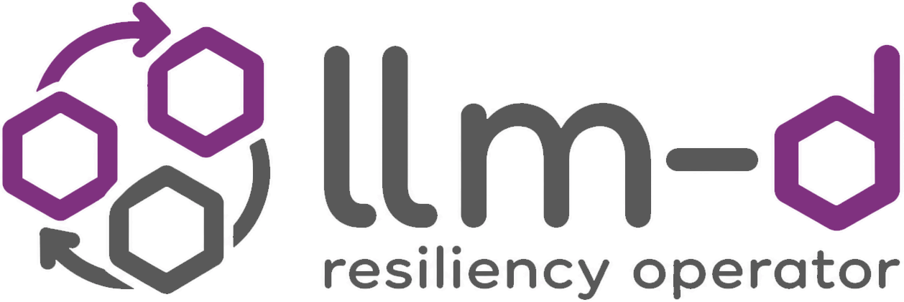

<div align="center">



<p>A Kubernetes operator that detects and recovers from failures in llm-d inference workloads.</p>

[](https://github.com/llm-d-incubation/llm-d-resiliency-operator/actions/workflows/ci-pr-checks.yaml)
[](LICENSE)

</div>

## Overview

The llm-d Resiliency Operator (IRO) watches llm-d inference deployments and reacts when serving degrades, so a multi-node model server can get back to healthy without a human in the loop.

This project is in early development under [llm-d-incubation](https://github.com/llm-d-incubation). See the [llm-d project](https://github.com/llm-d/llm-d) for how it fits into the wider stack, the [proposal](https://github.com/llm-d/llm-d/blob/main/docs/proposals/inference-resilience-operator.md) and the [WIP design doc](https://docs.google.com/document/d/1q4V2CcWMSrufy5LJE_Fv49kwCoFoPSTrBrrayzNxRqY/edit?usp=sharing).

## Prerequisites

- Go 1.25+
- Docker (for container builds)
- [pre-commit](https://pre-commit.com/) (for local development)

## Quick Start

```bash
# Clone the repo
git clone https://github.com/llm-d-incubation/llm-d-resiliency-operator.git
cd llm-d-resiliency-operator

# Install pre-commit hooks
pre-commit install

# Build
make build

# Run tests
make test

# Run linters
make lint
```

Running locally with current shell's kubeconfig:
```bash
go run cmd/main.go --pod-namespace=llm-d-wide-ep --pod-label-key=llm-d.ai/inference-serving
```

This requires that an llm-d inference engine is running in the specified namespace and has the specified label.
It also requires the RecoveryRequest CRD to be installed:
```bash
kubectl apply -f deploy/kubernetes/crd.yaml
```

## Development

See [CONTRIBUTING.md](CONTRIBUTING.md) for development guidelines, coding standards, and how to submit changes.

### Common Commands

```bash
make help           # Show all available targets
make build          # Build the project
make test           # Run tests with race detection
make lint           # Run Go and Python linters
make fmt            # Format Go and Python code
make image-build    # Build multi-arch container image
make pre-commit     # Run pre-commit hooks
```

## Contributing

We welcome contributions! Please see [CONTRIBUTING.md](CONTRIBUTING.md) for guidelines.

All commits must be signed off (DCO). See [PR_SIGNOFF.md](PR_SIGNOFF.md) for instructions.

## Security

To report a security vulnerability, please see [SECURITY.md](SECURITY.md).

## License

This project is licensed under the Apache License 2.0 - see [LICENSE](LICENSE) for details.
