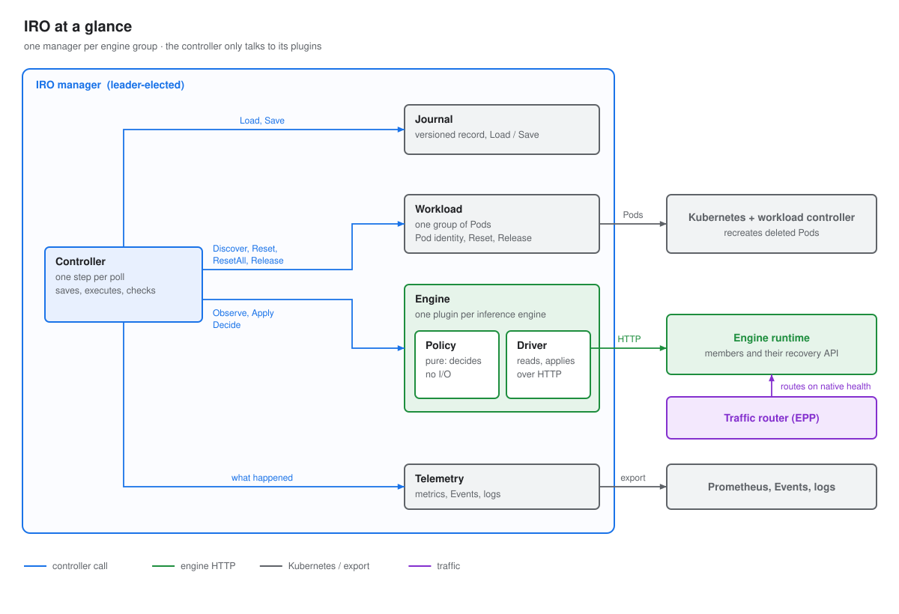
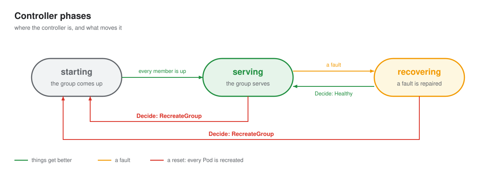
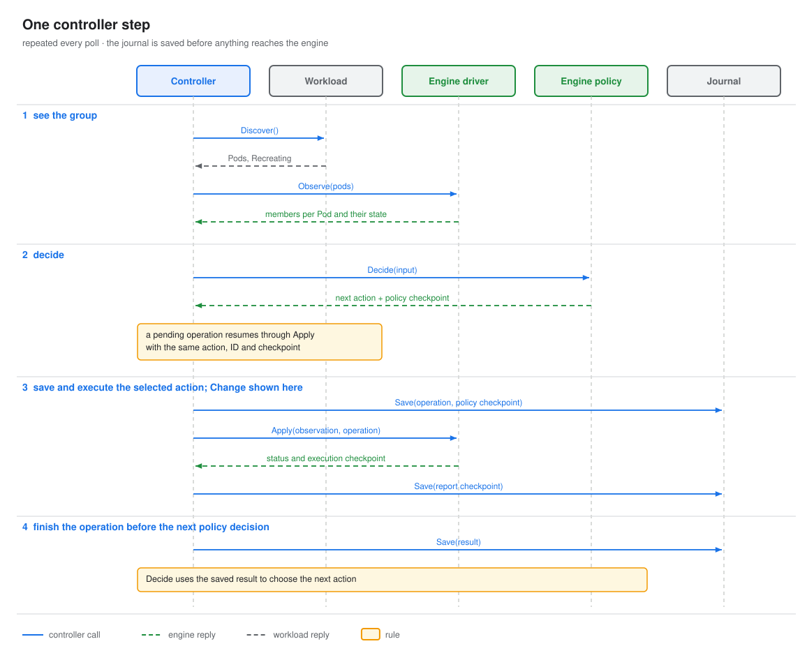
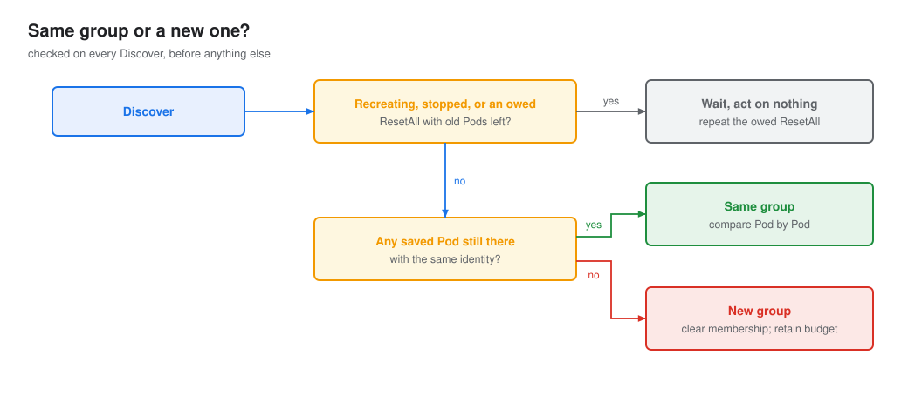
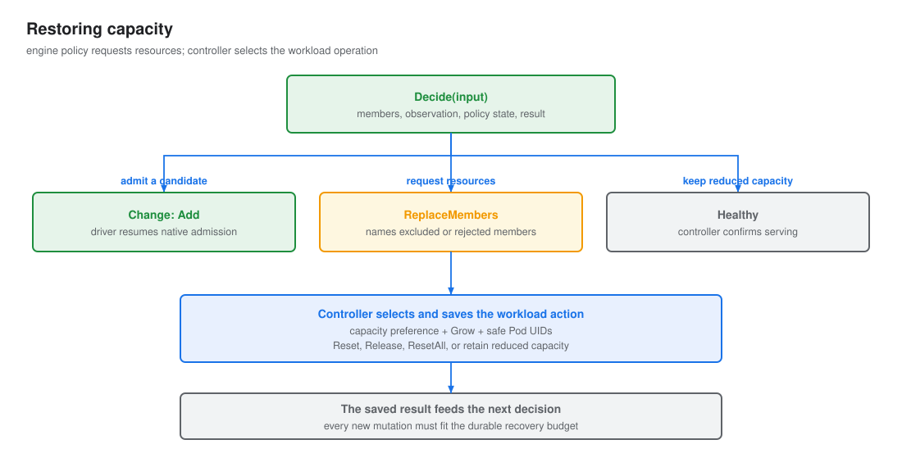

# Controller

## What it does

The controller keeps one engine group serving through faults. It runs one loop per group, on the elected
leader. When members die, it removes them in place so the rest keep serving. Once the group serves again, it
brings the failed Pods back. It resets the whole group only when nothing smaller can work, and it never gives up.

It owns everything that is not specific to an engine or a workload: the phases and their deadlines, whether
it is still the same group, matching Pods to members, saving state before acting, resets, bringing capacity
back, and the checks every plan must pass. It reads only the engine-neutral [`Member`](engines/index.md#objects)
fields and [`Pod`](workloads/index.md#objects) facts.

## What it talks to



| With | Calls | When | Gets back |
|---|---|---|---|
| Leader election | | always | the right to act: only the leader runs the loop |
| [Journal](journal.md) | `Load` | when it becomes the leader | the saved [`Record`](#objects) |
| | `Save` | before every action, and after each change | a new version, or a conflict |
| [Workload](workloads/index.md) | `Discover` | every poll | the group's Pods as they are now |
| | `Reset`, `ResetAll`, `Release` | when Pods must go | nothing; the next `Discover` shows the result |
| [Engine driver](engines/index.md#driver) | `Observe` | every poll | each member, its Pod and its state |
| | `Probe` | once, when a fault starts | whether the engine still answers |
| | `Apply` | to send a reconfig | which members accepted it |
| | `Verify` | after a reconfig succeeds | whether those members can generate |
| [Engine policy](engines/index.md#policy) | `Plan` | every poll, with no reconfig in flight | `Healthy`, `Wait`, `Change` or `Unrecoverable` |
| | `Progress` | every poll, with a reconfig in flight | `NotStarted`, `Running`, `Succeeded` or `Failed` |
| [Telemetry](telemetry.md) | `Recorder` | whenever something happens | nothing: best effort, never read back |

It never talks to the traffic router. The router follows the engine's own health, so a member the engine
reports out of service stops getting traffic without IRO.

## The life of a group



The controller is always in one of three states. There is no final state: it never gives up on a group.

| State | Meaning | The controller |
|---|---|---|
| `starting` | the group is coming up: a new group, or one that was just reset | waits for every member, then admits them all. No deadline: how fast the group comes up is the workload's call. |
| `serving` | the group serves, maybe with fewer members than it started with | checks the result of a recovery it just made, and [brings failed Pods back](#getting-back-to-full) |
| `recovering` | the engine reports a fault | removes dead members in place with a [reconfig](#repairing-a-fault), or retries |

| From | To | When |
|---|---|---|
| `starting` | `serving` | every member is up: the policy says `Healthy` |
| `serving` | `recovering` | the engine reports a fault: the policy says anything but `Healthy`, other than adding members back |
| `recovering` | `serving` | the fault is repaired: the policy says `Healthy`, or the reconfig succeeded |
| `serving` or `recovering` | `starting` | recovery in place cannot help, so the controller [resets the group](#resetting-the-group) |

## Every poll



Each poll runs one step, in this order. Every later section covers one part of it.

1. **See the group.** `Discover` the Pods and compare them with the journal: the same group, a new one, or
   one going away. See [seeing the group](#seeing-the-group).
2. **If `starting`**, wait for every member and admit them all on a `Healthy` plan. Stop here.
3. **Read the members.** `Observe` them and match each to its Pod.
4. **Check** that what the engine reports is safe ([C1, C4, C5](#safety-checks)).
5. **Decide and act.** Ask the policy for a `Plan`, or for `Progress` while a reconfig runs. Send a reconfig,
   verify one that succeeded, or reset. See [deciding](#deciding) and [repairing a fault](#repairing-a-fault).
6. **Restore capacity** if the group serves. See [getting back to full](#getting-back-to-full).

The step stops early when it cannot see the group, and while the old group of a reset is still going.

This example assumes an engine that can grow and the default `reset-pod` capacity policy.

| Poll | Discover | Observe | Policy says | Controller does | Phase, reconfig |
|---|---|---|---|---|---|
| 1 | 4 Pods `Ready` | all `Serving` | `Plan`: Healthy | nothing | serving |
| 2 | same | `m3` Terminal, `m0`-`m2` paused | `Plan`: Change, remove `m3@identity-d1` | enters `recovering`, saves, calls `Probe` once | recovering |
| 3 | same | same | same | waits: under 2 polls in `recovering` | recovering |
| 4 | same | same | same | checks the plan, saves reconfig `iro-ft-7c1e`, `Apply`, saves acceptances | recovering, reconfig in flight |
| 5 | same | survivors rebuilding | `Progress`: Running | waits, under the apply deadline | recovering, reconfig in flight |
| 6 | same | `m0`-`m2` healthy | `Progress`: Succeeded | marks `m3@identity-d1` excluded, clears the reconfig, saves, `Verify(m0, m1, m2)` | serving |
| 7 | same | same | `Plan`: Healthy | `pod-3` holds only excluded members: marks it `Removing`, saves, `Reset([pod-3 (UID d1)])` | serving |
| 8 | `pod-3` (UID d1) Terminating | `m0`-`m2` Serving | `Plan`: Healthy | waits | serving |
| 9 | `pod-3` (UID d2) Starting | same | `Plan`: Healthy | saves the new Pod, forgets UID d1 and `m3@identity-d1`. No deadline. | serving |
| ... | `pod-3` (UID d2) Ready | `m3` on UID d2 Joinable | `Plan`: Change, add `m3@identity-d2` | checks, saves reconfig, `Apply` | serving, reconfig in flight |
| ... | same | `m3@identity-d2` healthy | `Progress`: Succeeded | marks `m3@identity-d2` admitted, saves, verifies all reconfig participants and the added member | serving |

See the [member-death example](../failures/member-dies.md#poll-by-poll) for an engine-specific poll sequence.

## Taking over

Only the elected leader runs the loop. A new leader loads the journal and continues from the saved record, so
it picks up a recovery where the last leader stopped.

| The journal holds | The new leader |
|---|---|
| nothing (IRO's first run, or the record was deleted) | starts over in `starting`. A group that serves is admitted again, not reset. |
| a phase, no reconfig in flight | continues in that phase. Its deadlines restart. |
| a reconfig in flight | follows its `Progress`. It sends the same reconfig again only if no acceptance was saved and `Progress` says `NotStarted` (see [sending a reconfig](#sending-a-reconfig)). |
| `Verifying` members | continues the check |
| something it cannot read, or a phase it does not know | an unreadable record: logs it and tries again next poll. An unknown phase: starts over. |

Every save is compare-and-swap on the version the controller loaded or saved. If another writer saved first,
the save conflicts: the controller drops its state and loads again, and its deadlines restart.

See the [leader-change example](../failures/leader-dies.md) for an engine-specific recovery.

## Seeing the group

### Same group or a new one?

The workload only reports Pods as they are now. The controller decides what they mean by comparing them with
the Pods saved in its journal.



| Pod compared with the journal | Meaning | Controller does |
|---|---|---|
| saved, same identity, not `Terminating` | unchanged | nothing |
| saved as `Removing`, now gone or `Terminating` | the `Reset` or `Release` is happening | forgets it once it is gone |
| saved, not `Removing`, now gone or `Terminating` | its members are lost | adds them to the observation as Terminal ([lost members](engines/index.md#members)), so the policy plans as usual and a reconfig can remove them |
| saved, not `Removing`, same UID with a new identity: an engine container restarted in place | its members are lost. The restarted container's members are not in the group. | the same for the old members. It keeps the Pod's old identity while it tracks them, so once a reconfig removed them the Pod is [restored](#getting-back-to-full) like a failed Pod. The new members are never candidates. A Pod that restarts before its members were recorded is only a slower start. |
| not saved, `Starting` | a replacement Pod is loading | saves it and waits |
| not saved, `Ready` | a replacement Pod is up | its members, as `Observe` reports them, are candidates |

A `ResetAll` is owed when every saved Pod is `Removing`. Until none of them remain, the controller repeats it
and acts on nothing else. Then no saved Pod is left, and the new Pods form a new group.

While `starting`, every Pod belongs to the group being started. The controller records the Pods again on
every poll and does not match or check members. On the first `Healthy` plan it admits every member it saw.

### Pods and members

`Discover` reports Pods. `Observe` reports members, each with the Pod it runs on. The controller joins the two
by `Member.ID()` (`m3@identity-d1`) and keeps each member as:

| State | Meaning |
|---|---|
| candidate | on a new Pod, not in the group yet |
| admitted | in the group |
| excluded | a reconfig removed it; its Pod may still be reset |
| rejected | stays out until the next group: a candidate that could not join, or an excluded member whose Pod is kept |

| Case | Controller does |
|---|---|
| member reported on a saved Pod | matches it by ID |
| member reported on a new, `Ready` Pod | records it as a candidate |
| admitted member reported `Unknown`, or not reported while its Pod is unchanged | unknown: see [members it cannot read](#members-it-cannot-read) |
| admitted member on a Pod that is gone, `Terminating` or has a new identity | lost: added to the observation as Terminal, `Detail: "pod lost"` |
| member reported under a restarted Pod's new identity | not tracked, never a candidate. C5 still applies: it must not serve. |

### Members it cannot read

An unknown member is one IRO cannot read now: it is never Serving, never Terminal, and never put in `Remove`
by a new plan. Lost members do not count as read.

| Admitted members IRO can read | Controller does |
|---|---|
| all that are not lost | as usual |
| some, and others are unknown | the group is not healthy: a `Healthy` plan, or a grow in `serving`, counts as a fault. A `Change` that names an unknown participant is not sent: the controller waits. If they stay unknown, the diagnosis deadline resets the group. |
| none | it [cannot see the group](#when-it-cannot-see-the-group) |

An unknown member never becomes Terminal by timeout. IRO cannot tell a hung member from one only IRO cannot
reach, and the router may still send it traffic: removing it would break C1. Only the engine (`Terminal`) or
the workload (the Pod is gone, `Terminating` or restarted) proves a process is gone.

### When it cannot see the group

A failed `Discover`, or an `Observe` that reads no admitted member, proves nothing about the group: IRO may be
the one cut off. The controller keeps the phase, opens no incident, asks for no plan, notes the time in
`UnseenSince`, and pauses its deadlines. When it sees the group again, its deadlines move forward by the time
it could not see.

A group whose every member hangs, or whose single frontend hangs, looks the same, so the wait is bounded: once
no admitted member has been readable for `--ft-unseen-timeout`, the group is reset (reason `unseen`). The
timeout is long, so a short blip on IRO's side never resets a group that serves. A failed `Discover` never
resets: IRO cannot see the Pods it would name.

The timeout counts only time IRO could read the engine and got nothing. Time when `Discover` failed never looked
at the engine, so once `Discover` works again the clock restarts, and the engine gets its own full
`--ft-unseen-timeout` before the group is reset. This holds even if the engine was already unreadable before
`Discover` failed: IRO then waits longer, never shorter.

See the [unreadable-group example](../failures/iro-blind.md).

## Deciding

### What the plans mean

The policy decides; the controller acts on its answer by state.

| Plan | In `serving` | In `recovering` |
|---|---|---|
| `Healthy` | fine | the fault is over: back to `serving` |
| `Change` that only adds members | a reconfig to grow back | a reconfig |
| other `Change` | a fault: go to `recovering` | a reconfig, sent no sooner than 2 polls in |
| `Wait` | a fault: go to `recovering` | wait, under the diagnosis deadline |
| `Unrecoverable` | a fault: go to `recovering` | [reset the group](#resetting-the-group) |

On entering `recovering` the controller calls `Probe` once. In `starting`, any plan but `Healthy` is ignored.
While a reconfig runs, the controller asks for `Progress` instead of a plan.

### Safety checks

The controller refuses any plan that breaks these rules, so a wrong policy can stall or reset a group but
cannot exclude a member that still serves.

| # | Rule | Why |
|---|---|---|
| C1 | `Remove` holds only members that are Terminal when the plan is checked: an unknown one fails. They stay Terminal until the reconfig succeeds; one that later reads unknown is not checked. | the router follows native health. A removed member that still serves gets traffic outside the group. |
| C2 | `Add` holds only candidates that are Joinable, on Pods that are `Ready` and unchanged | a stale Pod must not join |
| C3 | `Participants` and `Remove` are admitted members, `Add` holds candidates, the three are disjoint, and `Participants` is not empty | a reconfig must name a real, consistent membership change |
| C4 | Excluded members stay Terminal. An unknown one is not checked: it cannot serve. | otherwise an excluded member could take traffic again |
| C5 | Members that are not admitted are not Serving, except those the reconfig in flight adds | a joiner must not take traffic before it is in the group |
| C6 | A reconfig that changes no membership cannot repeat within `FlapWindow` | stops retry loops |
| C7 | One reconfig at a time. Every member a reconfig names is in the observation it is planned on, lost members included. `Apply` refuses any other reconfig. | a stale reconfig cannot apply to a changed group |
| C8 | `Reset` and `Release` name only Pods whose every member is excluded, after the reconfig that removed them finished | the engine must no longer depend on a Pod before it goes |

Every plan is checked against C1 to C3, and every observation against C1, C4 and C5, in `serving` and
`recovering`. In `starting` no member is admitted yet. C8 limits what the controller itself sends, so it is
never broken at runtime. A broken check [resets the group](#resetting-the-group).

## Repairing a fault

A reconfig is the one engine action IRO can have in flight. It is saved in the journal before it is sent, and
cleared when `Progress` reports `Succeeded` or `Failed`. A reconfig runs in `recovering` to fix a fault, and in
`serving` to admit the members of a Pod that was reset.

### Sending a reconfig

1. Check the plan (C1 to C3, C6, C7), and wait while it names a member IRO cannot read.
2. Save the reconfig, then `Apply` it, then save the acceptances.
3. Follow `Progress` every poll until it reports `Succeeded` or `Failed`.

**At most one run.** No saved acceptances means the send was never confirmed: the leader may have died before
`Apply` reached the engine. When `Progress` then says `NotStarted`, the controller checks the reconfig again,
saves, and sends the same reconfig: same ID, same members. A reconfig that no longer passes is dropped, since
nothing reached the engine, and the controller plans again. A resend restarts the apply deadline and is not a
new reconfig for C6. With acceptances saved, `NotStarted` counts as `Running`. An engine that cannot prove
that no member got a reconfig never says `NotStarted`: the reconfig then fails, or runs into its deadline.

| `Progress` says | Controller does |
|---|---|
| `Running` | waits, under the apply deadline |
| `Succeeded` | marks removed members excluded and added members admitted, then [checks the result](#checking-the-result) |
| `Failed`, scope `Joiners` | only the joiners failed: marks them rejected; the group is untouched |
| `Failed`, scope `Group` | the group may be broken: [resets it](#resetting-the-group) |
| `NotStarted` | resends, as above, if no acceptance was saved |

### Deadlines

| | No reconfig in flight | Reconfig in flight |
|---|---|---|
| Deadline | `--ft-diagnosis-timeout`, from the fault | `--ft-apply-timeout`, from when the reconfig was sent |
| Catches | an engine that never reaches a state IRO can act on | a reconfig that never finishes |

Deadlines are paused while the workload reports `Recreating`, and while IRO cannot see the group. Both restart
when a new leader takes over. A new group drops the reconfig in flight: the workload is already replacing
everything.

### Checking the result

After a reconfig succeeds, the controller saves its participants and joiners in `Verifying` and calls
`Verify` on them every poll until it passes. Members the reconfig removed are not checked.

One failed request is not a fault: a failure is retried for `--ft-verify-timeout`, and only a member that
still cannot generate after that resets the group (reason `verify_failed`). If the engine reports a fault
meanwhile, the group goes to `recovering`; the check resumes when it serves again. A new leader finds
`Verifying` in the journal and continues the check. Verify runs only here: IRO checks what it changed, nothing
else.

## Getting back to full

Capacity never comes from new Pods. It comes back by resetting the failed Pod, or the whole group. This runs
only while the group is `serving`; a fault comes first.



1. Once the last reconfig passed `Verify`, on a poll whose plan is `Healthy`, the controller looks for Pods that
   hold only excluded members. It marks them all `Removing`, saves once, and names them all in one call (C8).
2. After a `Reset`, the new Pods start on their own. Their members become candidates as each Pod becomes
   `Ready`, and the policy admits them in ordinary reconfigs.
3. There is one try, no budget. If the Pod cannot be reset, or its new members cannot join, the group keeps
   serving with fewer members. The members are marked rejected, so the Pod is not tried again.
4. Full capacity comes back with the next group: any reset, or a recreation by the workload.

| `--ft-capacity-restore` | The failed Pod | When it cannot come back |
|---|---|---|
| `reset-pod` (default) | reset once | the group serves with fewer members |
| `reset-all` | the whole group is reset (reason `capacity`), even when the Pod still holds admitted members | never below full |
| `release` | given back to the workload | the group serves with fewer members |

A call that names several Pods and returns `ErrUnsupported` is repeated for each Pod alone, so one Pod the
workload can never replace does not keep the others below full. Other workload errors are retried next poll.

See the [multiple-member failure example](../failures/several-members-die.md).

## Resetting the group

A reset (`ResetAll`) recreates every Pod of the group. The controller marks every saved Pod `Removing`, goes to
`starting`, and repeats the call every poll until those Pods are gone. How often a group may be recreated, and
when to stop, is the workload's restart policy. When the workload stops recreating the group
(`RecreateStopped`), the controller waits and acts on nothing until it does.

| Reason | When | Step by step |
|---|---|---|
| `unrecoverable` | the policy says `Unrecoverable`, or a plan fails C1 to C3 | [the engine cannot recover in place](../failures/unrecoverable.md) |
| `reconfig_failed` | `Progress` says `Failed` for the group, or `Apply` fails | [a reconfig fails](../failures/reconfig-fails.md) |
| `diagnosis_deadline` | in `recovering` past `--ft-diagnosis-timeout` with nothing sent | [a member hangs](../failures/member-hangs.md), [a member cannot be read](../failures/member-unreadable.md) |
| `apply_deadline` | a reconfig in flight past `--ft-apply-timeout` | [a reconfig never finishes](../failures/reconfig-hangs.md) |
| `flap` | a reconfig that changes no membership would repeat within `FlapWindow` (C6) | [a transient fault](../failures/transient-fault.md) |
| `verify_failed` | a checked member still cannot generate after `--ft-verify-timeout` | [the group cannot generate after a recovery](../failures/verify-fails.md) |
| `exclusion_broken` | the engine reports something C1, C4 or C5 forbids | |
| `capacity` | `--ft-capacity-restore=reset-all` and a member is excluded or rejected | [the failed Pod cannot come back](../failures/capacity-not-restored.md) |
| `unseen` | no admitted member readable for `--ft-unseen-timeout` | [IRO cannot see the group](../failures/iro-blind.md) |

## Dry run

With `--ft-dry-run` the controller reads the group and decides as usual, but does nothing: no Pod reset, no
`Probe`, `Apply` or `Verify`, and the record stays in memory instead of the journal. The record keeps the action
the controller skipped, in `WouldDo`, so the next poll does not start over.

On every poll the controller compares what it would do now with what the state already says, and records (logs)
only when that changes.

```text
poll 1: dp3 dead  -> state empty           -> record "would remove dp3"
poll 2: dp3 dead  -> state = remove dp3    -> same, stay quiet
poll 3: dp3 dead  -> state = remove dp3    -> same, stay quiet
poll 4: all dead  -> state = remove dp3    -> changed, record "would reset all"
poll 5: healthy   -> state = reset all     -> changed, record "recovered without IRO"
```

Each poll is deterministic: the action depends only on the record, the live group and the time. A dry run shows
only the first action of a fault. What would follow depends on how the engine reacts to an action that never ran.
Since nothing is repaired, a fault that no rank notices leads to "would reset all" after `--ft-diagnosis-timeout`.
Without `Probe`, the ranks notice a fault only through real traffic. Once the controller would reconfigure, the
diagnosis deadline no longer applies, since a real run would have sent the reconfig already. The engine may still
give up on its own, for example vLLM after `engine_recovery_timeout_sec`, and then the log shows "would reset all:
unrecoverable".

## Guarantees

| Guarantee | How |
|---|---|
| One writer per group | runs only on the elected leader. Journal saves are compare-and-swap on the version this controller loaded or saved; after a conflict it loads again. |
| At most one run per reconfig | saved before `Apply`, acceptances saved after. Sent again, same ID, only when the send was never confirmed and `Progress` says `NotStarted`. A member that already got it does not start it again. |
| Repeatable workload calls | `Reset`, `ResetAll` and `Release` are saved first and repeated until `Discover` shows the result |
| One reconfig at a time | a new plan is asked for only when no reconfig is in flight |
| Faults come first | capacity is restored only while `serving` |
| A failed save never advances the phase | the in-memory state keeps the last saved phase |
| Never resets a group it cannot see | a failed `Discover` waits. An `Observe` that reads no admitted member waits with deadlines paused, up to `--ft-unseen-timeout`. |
| Resets hit only what failed | `Reset` names the failed Pods by UID; `ResetAll` names the saved Pods by UID. Both are repeated, one call per poll, until those Pods are gone. |
| Never gives up on its own | no reset budget and no final state. The workload's restart policy paces resets and decides when to stop. |
| No startup deadline | `starting`, and a reset Pod coming back, take as long as they need |

## Configuration

| Flag | Default | Meaning |
|---|---|---|
| `--enable-engine-ft` | `false` | turn the controller on (needs `--leader-elect`) |
| `--ft-dry-run` | `false` | decide as usual, but only log what recovery would do. See [dry run](#dry-run). |
| `--engine` | | engine implementation |
| `--workload` | | workload implementation |
| `--ft-poll-interval` | 1s | how often the leader reads the group and acts |
| `--ft-diagnosis-timeout` | 75s | longest time in `recovering` with nothing sent |
| `--ft-apply-timeout` | 90s | longest time a reconfig may stay in flight |
| `--ft-verify-timeout` | 2m | how long a failed check after a reconfig is retried. 0 resets on the first failure. |
| `--ft-unseen-timeout` | 10m | how long no admitted member may be readable before the group is reset. 0 waits forever. |
| `--ft-capacity-restore` (target) | `reset-pod` | see [getting back to full](#getting-back-to-full) |
| no flag | 2m | `FlapWindow`, for C6 |

Each engine and workload implementation registers its own flags.

## API reference

### Interface

```go
func New(ctx context.Context, workload Workload, engine Engine, journal Journal, recorder Recorder, config Config) (Controller, error)

type Controller interface {
    Step(ctx context.Context) error
}
```

A runner calls `New` until the journal loads, then `Step` every `PollInterval` while this process leads. When
`Step` returns `ErrConflict`, the runner drops the controller and calls `New` again. `New` and the defaults
come with the implementation; the code defines `Controller` and its objects.

### Objects

```go
type Config struct {
    PollInterval     time.Duration   // 1s
    DiagnosisTimeout time.Duration   // 75s
    ApplyTimeout     time.Duration   // 90s
    VerifyTimeout    time.Duration   // 2m
    UnseenTimeout    time.Duration   // 10m
    FlapWindow       time.Duration   // 2m: check C6
    CapacityRestore  CapacityRestore // reset-pod (default) | reset-all | release
}

type Phase string // starting | serving | recovering

type CapacityRestore string // reset-pod | reset-all | release

type MemberState string // candidate | admitted | excluded | rejected

// PodRecord is what the controller remembers about one Pod.
type PodRecord struct {
    Name     string
    Identity string
    Node     string // so an incident can name the node of a Pod that is already gone
    Removing bool   // asked to go, through Reset, ResetAll or Release
}

// Record is the controller's whole state. It is what the journal stores.
type Record struct {
    Phase  Phase
    Since  time.Time // when the phase started. The diagnosis deadline counts from here.
    Reason string

    Pods    map[string]PodRecord // by UID. Also what ResetAll names.
    Members map[MemberID]MemberState

    Reconfig      *Reconfig  // in flight, nil when none
    ReconfigSince time.Time  // the apply deadline counts from here
    Acceptances   []Acceptance
    Verifying     []MemberID // members of a reconfig that succeeded, not yet checked with Verify

    LastNoChangeReconfig time.Time // check C6
    VerifyFailedSince    time.Time
    UnseenSince          time.Time // Discover failed, or Observe read no admitted member. Deadlines do not count this time.
    UnseenByDiscover     bool      // Discover failed since UnseenSince: the clock restarts once Discover works again
    RecreateStopped      bool      // from the last Discover, so people can see the workload gave up

    Incident *Incident // the open incident, nil when none. Closed ones go to telemetry.
}
```

`Reconfig`, `Acceptance` and `MemberID` come from the [engine](engines/index.md#objects). `Incident` comes
from [telemetry](telemetry.md#objects).

The record after poll 5 of [every poll](#every-poll), as the journal stores it and `Recorder.Stepped` receives it:

```yaml
Phase: recovering
Reason: "m3 is dead; survivors paused"
Reconfig: {ID: iro-ft-7c1e, Participants: [m0@identity-a1, m1@identity-b1, m2@identity-c1], Remove: [m3@identity-d1]}
Members: {m0@identity-a1: admitted, m1@identity-b1: admitted, m2@identity-c1: admitted, m3@identity-d1: admitted}
RecreateStopped: false
```

### New

Builds the controller and loads its state.

| | |
|---|---|
| **Input** | a [`Workload`](workloads/index.md#interface), an [`Engine`](engines/index.md#interface), a [`Journal`](journal.md#interface), a [`Recorder`](telemetry.md#interface), a [`Config`](#objects) |
| **Output** | a `Controller`, or an error |
| **Side effects** | `Journal.Load` |

```go
New(...) // empty journal (first run):         Record{Phase: starting}
New(...) // leader changed during a reconfig:  Record{Phase: recovering, Reconfig: iro-ft-7c1e, ...}
New(...) // journal unreadable or not valid:   error. The runner logs it and calls New again next poll.
New(...) // after a save conflicted:           Record as saved by the other writer. Deadlines restart.
New(...) // the record was deleted:            starting
New(...) // a phase this version does not know: starting
```

### Step

Runs one poll: see the group, decide, act. See [every poll](#every-poll).

| | |
|---|---|
| **Input** | none |
| **Output** | `nil`, or an error that the runner logs. An error before a save leaves the saved state as it was. A workload call that fails after its save is repeated on the next poll, and its error is returned once the step has saved. |
| **Side effects** | any of `Journal.Save`, `Probe`, `Apply`, `Verify`, `Reset`, `ResetAll`, `Release`, and [`Recorder`](telemetry.md#interface) calls for what happened |
