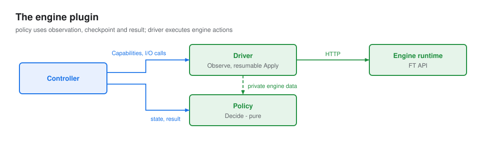

# Engine

## What it does

The engine plugin is everything IRO knows about one inference engine. It reads the engine's members, says what
should happen to them, and sends the engine its recovery instructions. The controller never sees an engine's
ranks, ports or status strings: only what this plugin reports. Each engine brings its own plugin.



It has two halves, so the decisions can be tested without a cluster and a new leader reaches the same decision
from the same observation.

### Driver

Does the I/O. It reports which members run on each Pod and their state, sends reconfigs, and runs inference
probes. It keeps no memory: whatever it needs travels in the observation. Every call is bounded by a timeout,
so a hung engine cannot stall the controller.

### Policy

Decides. Given what the driver saw, it says which members should leave or join, and how the reconfig in flight
is going. No I/O, no clock, no globals: the same input gives the same answer on any leader.

## What it talks to

| With | Calls | When | Returns |
|---|---|---|---|
| Controller → driver | `Observe` | every poll | each member, its Pod and its state |
| | `Probe` | once, when a fault starts | whether the engine still answers |
| | `Apply` | to send a reconfig | which members accepted it |
| | `Verify` | before recovery is declared complete | whether those members can generate |
| Controller → policy | `Plan` | every poll, with no reconfig in flight | what should happen now |
| | `Progress` | every poll, with a reconfig in flight | how the reconfig is going |
| Controller | `Capabilities` | once | what the engine can do at all |
| Driver → engine runtime | engine-specific, usually HTTP | inside the calls above | |

The engine never talks to the workload or to Kubernetes, and knows nothing about phases or deadlines. The
traffic router reads the engine's own health directly, not through this plugin.

## Members

A member is one engine process that serves: a rank, a worker. The driver reports each member with the Pod it
runs on.

| Field | Means | The driver must |
|---|---|---|
| `Name` | the engine's name for it, unique within its Pod, such as `m3` | |
| `Serving` | the router may send it traffic: the engine's own health | report what the router uses, and never `Serving` for a candidate (checks [C1 and C5](../controller.md#safety-checks)) |
| `Terminal` | it will never serve again | never report it `Serving` again, only `Terminal` or `Unknown` (check C4) |
| `Unknown` | the driver could not read it now. `Serving`, `Terminal` and `Joinable` are then false. | use it whenever it cannot read a member, never guess `Terminal`: only a process known to be gone may be removed (check C1) |
| `Joinable` | for a candidate only: it can be admitted now | report it false while the Pod is not `Ready`, so a loading Pod is not a candidate yet |

A Pod gives all of its members, or none when the driver cannot list them, so at the end of `starting` the
controller admits exactly the members it saw.

A member's ID is `Name@PodIdentity`, such as `m3@identity-d1`. The Pod's identity changes when the Pod is replaced or its
engine restarts, so an ID names exactly one process in one Pod's life, and a replaced member gets a new ID.

`Serving` is not "healthy". `Serving` is what the router sees. "Healthy" is the policy's `Healthy` plan, which
may also use what the router does not see, such as a process that already exited.

**Lost members.** When a Pod is gone, `Terminating`, or has a new identity, the driver no longer sees the
members that ran on it. Before it calls `Plan`, `Progress`, `Apply` or `Verify`, the controller adds each one to
the observation with its Pod, identity and name, `Terminal: true` and `Detail: "pod lost"`. The policy plans
them like any terminal member, so a shrink removes them. A container probe that restarts an engine container
loses its members the same way, so each engine page says which probes are safe while a member is paused for
recovery.

## Every poll

What the controller asks the engine during one recovery, in order:

1. `Observe` the members, every poll.
2. On a fault, `Probe` once, so the engine notices a dead peer it has not hit yet.
3. Ask the policy for a `Plan`. On a `Change`, the controller checks it and calls `Apply`.
4. Ask the policy for `Progress` every poll until the reconfig succeeds or fails.
5. On success, `Verify` the members that took part. A fault that clears without a reconfig checks every admitted member.

## Reading members

`Observe` reports the members running on the given Pods, and their state.

| | |
|---|---|
| **Input** | the Pods from [`Discover`](../workloads/index.md#reporting-the-group) |
| **Output** | an [`Observation`](#objects). Never fails: a member the driver cannot read is `Unknown`, and a Pod whose members it cannot list gives none. |
| **Side effects** | none |

Right after `m3` dies:

```yaml
Members:
- {Pod: pod-0/a1, PodIdentity: identity-a1, Name: m0, Serving: false, Terminal: false, Detail: "paused, waiting for instruction"}
- {Pod: pod-1/b1, PodIdentity: identity-b1, Name: m1, Serving: false, Terminal: false, Detail: "paused, waiting for instruction"}
- {Pod: pod-2/c1, PodIdentity: identity-c1, Name: m2, Serving: false, Terminal: false, Detail: "paused, waiting for instruction"}
- {Pod: pod-3/d1, PodIdentity: identity-d1, Name: m3, Serving: false, Terminal: true,  Detail: "dead"}
Engine: <driver-private: API addresses, raw engine status>
```

`Engine` holds whatever the same engine's driver and policy need later, such as addresses. The driver may cache
internally, keyed by Pod identity, but a new leader must need no warm-up. If `pod-3` is deleted, `Observe`
returns `m0`-`m2` and the controller adds `{Pod: pod-3/d1, PodIdentity: identity-d1, Name: m3, Terminal: true,
Detail: "pod lost"}`.

## Noticing a fault

`Probe` nudges the engine to notice a fault it has not seen yet. It may do nothing.

| | |
|---|---|
| **Input** | the latest observation |
| **Output** | `nil`, or an error. The controller only adds the error to its reason. |
| **Side effects** | engine-specific, bounded, never user-visible |

`m3`'s process has exited, but `m0`-`m2` are idle and still report healthy: they only notice a dead peer inside
a collective operation. The controller calls `Probe` once when it enters `recovering`. The driver sends one short
completion through a healthy member, the collective fails, and on the next `Observe` `m3` is `Terminal` and the
others are paused.

## Deciding

`Plan` says what should happen now. It is pure: no I/O, no clock.

| | |
|---|---|
| **Input** | the latest observation, the admitted members, the candidates |
| **Output** | a [`Plan`](#objects) |

| Plan | Means | The controller |
|---|---|---|
| `Healthy` | nothing to do | goes to `serving`, or stays there |
| `Wait` | something is wrong, but the engine needs time | waits, under its deadline |
| `Change` | send this reconfig | checks it, saves it, sends it |
| `Unrecoverable` | recovery in place cannot help | resets the group |

Every `Change` is one of four shapes:

| Change | Remove | Add |
|---|---|---|
| retry | nobody | nobody |
| shrink | terminal members | nobody |
| grow | nobody | joinable candidates |
| replace | terminal members | joinable candidates |

[example engine-plans]: ../../scenarios/engine-plans.json

```go
// m3 dead, m0-m2 paused:
Plan(obs, admitted: [m0@identity-a1 m1@identity-b1 m2@identity-c1 m3@identity-d1], candidates: [])
// {Kind: Change, Participants: [m0@identity-a1 m1@identity-b1 m2@identity-c1], Remove: [m3@identity-d1], Reason: "m3 is dead; survivors paused"}

// later, pod-3 was reset, is back as UID d2, and m3 on it is Joinable:
Plan(obs, admitted: [m0@identity-a1 m1@identity-b1 m2@identity-c1], candidates: [m3@identity-d2])
// {Kind: Change, Participants: [m0@identity-a1 m1@identity-b1 m2@identity-c1], Add: [m3@identity-d2], Reason: "candidate ready"}

// m2 is unhealthy, but nobody is dead yet:
// {Kind: Wait, Reason: "waiting for the engine to finish diagnosis"}
```

| Rule | Why |
|---|---|
| `Wait` only for a fault the engine is still working out | the controller owns the deadlines |
| `Healthy` while candidates cannot be admitted yet | a candidate waiting to join is not a fault |
| Never `Healthy` while an admitted member is `Unknown` or missing | the controller treats it as a fault anyway |
| `Unrecoverable` when recovery in place cannot help | the controller resets |
| `Add` only if the engine [can grow](#growing-back) | the controller resets a single Pod only when the engine can re-admit its members |
| Remove and add in one reconfig (replace) only if the engine supports it | fewer reconfigs during a fault |
| A `Change` must pass the controller's [checks C1 to C7](../controller.md#safety-checks) | otherwise the controller resets |

## Sending a reconfig

`Apply` sends a reconfig to every participant and joiner.

| | |
|---|---|
| **Input** | the observation the reconfig was planned on, and the [`Reconfig`](#objects) |
| **Output** | one [`Acceptance`](#objects) per member it sent to: accepted means started, not done. An error unless every one accepted. |
| **Side effects** | the engine starts the reconfig |

```go
Apply(ctx, obs, Reconfig{
    ID:           "iro-ft-7c1e",
    Participants: []MemberID{"m0@identity-a1", "m1@identity-b1", "m2@identity-c1"},
    Remove:       []MemberID{"m3@identity-d1"},
})
// all accept:    [{m0@identity-a1 true} {m1@identity-b1 true} {m2@identity-c1 true}], nil
// one refuses:   [{m0@identity-a1 true} {m1@identity-b1 false "expected 202, got 409"} {m2@identity-c1 true}], error
// pod-3 deleted: obs holds m3@identity-d1 as the controller added it, Apply sends to m0-m2 and all accept
```

An error means the reconfig did not start everywhere, and the controller resets the group.

| Rule | Why |
|---|---|
| Refuse, before sending anything, a reconfig that names a member missing from the observation. A removed member needs no driver data: a lost one has none. | controller check C7. A lost Pod, the most common fault, still shrinks in place. |
| A member that already got a reconfig never starts it again, so the same ID is safe to send twice | a new leader may resend a reconfig whose send it cannot confirm, and the old leader's late send may still arrive |
| The engine reports which reconfig each member is working on | `Progress` can tell this reconfig from another one |

## Following a reconfig

`Progress` says how the reconfig in flight is going. It is pure: no I/O, no clock.

| State | Means | The controller |
|---|---|---|
| `NotStarted` | the engine can prove no member got it | resends it, if no acceptance was saved |
| `Running` | not done yet | waits, under the apply deadline |
| `Succeeded` | every participant finished it | checks the result with `Verify` |
| `Failed`, scope `Joiners` | only the joiners failed; admitted members are untouched | rejects the joiners, keeps the group |
| `Failed`, scope `Group` | the group may be broken | resets the group |

```go
// no participant got iro-ft-7c1e yet, and the engine can prove it: {State: NotStarted}
// survivors still rebuilding:             {State: Running}
// m0-m2 healthy, finished iro-ft-7c1e:   {State: Succeeded}
// m1 reports its FT operation failed:     {State: Failed, Scope: Group, Reason: "m1@identity-b1: FT failed: ..."}
// a joiner failed, survivors untouched:   {State: Failed, Scope: Joiners, Reason: "m3@identity-d2 could not join"}
```

| Rule | Why |
|---|---|
| Stay `Running` until the engine reports a result for this reconfig, or proves no member got it | the apply deadline covers a reconfig that never finishes |
| `NotStarted` only when every participant and joiner is observed, could start the reconfig now and has not got it, and the engine would still show a reconfig a member got earlier | otherwise a reconfig that finished before a new fault looks unsent, and sending it again would run it twice |
| `Failed` with scope `Joiners` only when admitted members are untouched | otherwise the group may be broken and must be reset |

## Checking the result

`Verify` sends one real, bounded inference request through each named member. After a reconfig succeeds, the
controller checks its participants and joiners. A fault that clears without a reconfig checks every admitted
member.

| | |
|---|---|
| **Input** | the latest observation, and the members to check |
| **Output** | `nil` when every member produced tokens; otherwise an error naming every member that did not |
| **Side effects** | a few tokens of inference, marked so they are not counted as user traffic |

```go
Verify(ctx, obs, []MemberID{"m0@identity-a1", "m1@identity-b1", "m2@identity-c1"})
// nil
// or: error "m1@identity-b1: no tokens generated". The controller retries every poll for --ft-verify-timeout, then resets.
```

## Growing back

`Capabilities` says what the engine can do at all. Today it has one field: `Grow`, whether the engine can admit
new members into a running group.

An engine that cannot grow returns `{Grow: false}`. The controller then never resets a single Pod, since the
engine could not take its members back. With the default `--ft-capacity-restore`, the group keeps serving with
fewer members; with `reset-all`, IRO resets the whole group. Shrinking needs no capability: a policy that cannot
shrink never plans `Remove`.

## API reference

### Interface

```go
type Engine interface {
    Capabilities() Capabilities
    Driver
    Policy
}

type Driver interface {
    Observe(ctx context.Context, pods []Pod) Observation
    Probe(ctx context.Context, observation Observation) error
    Apply(ctx context.Context, observation Observation, reconfig Reconfig) ([]Acceptance, error)
    Verify(ctx context.Context, observation Observation, members []MemberID) error
}

type Policy interface {
    Plan(observation Observation, admitted, candidates []MemberID) Plan
    Progress(observation Observation, reconfig Reconfig) Progress
}
```

`Pod` and `PodRef` come from the [workload](../workloads/index.md#objects).

### Objects

```go
type Capabilities struct {
    Grow bool // can admit new members into a running group
}

type Member struct {
    Pod         PodRef
    PodIdentity string
    Name        string
    Serving     bool
    Terminal    bool
    Unknown     bool
    Joinable    bool
    Detail      string // for status and logs only
}

type MemberID string // Name@PodIdentity

func (member *Member) ID() MemberID { return MemberID(member.Name + "@" + member.PodIdentity) }

// Observation is what the driver saw in one Observe call, plus the lost members the controller adds.
type Observation struct {
    Members []Member
    Engine  any // driver-private, for the same engine's driver and policy
}

// Reconfig is one recovery or resize action. The controller builds it from a Plan.
type Reconfig struct {
    ID           string     // unique, assigned by the controller
    Participants []MemberID // admitted members that take part
    Remove       []MemberID // admitted members that leave
    Add          []MemberID // candidates that join
}

type Acceptance struct {
    Member   MemberID
    Accepted bool // started, not done
    Error    string
}

type Plan struct {
    Kind         PlanKind // Healthy | Wait | Change | Unrecoverable
    Participants []MemberID
    Remove       []MemberID
    Add          []MemberID
    Reason       string
}

type PlanKind string

type Progress struct {
    State  ProgressState // NotStarted | Running | Succeeded | Failed
    Scope  FailureScope  // set when State is Failed: Joiners | Group
    Reason string
}

type ProgressState string
type FailureScope string
```
