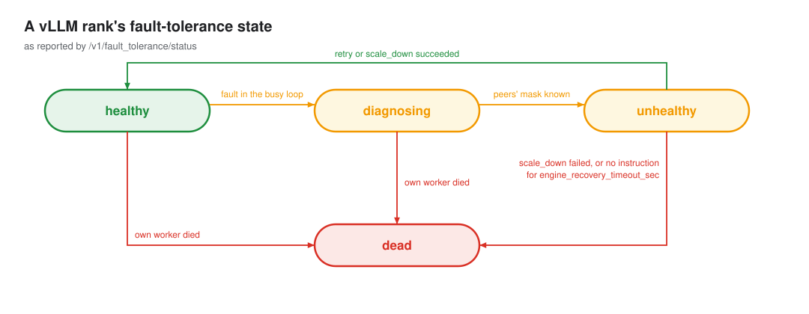

# vLLM engine

How vLLM implements the [engine contract](index.md), on top of the vLLM fault tolerance API
from [vllm-project/vllm#46370](https://github.com/vllm-project/vllm/pull/46370). Code: `internal/engine/vllm`.

## What vLLM gives

Each data parallel rank runs its own API server (external load balancing, `--data-parallel-size-local 1`).
On `--enable-fault-tolerance`, a rank that hits a fault stops serving and waits for an instruction:

| Endpoint | Use |
|---|---|
| `GET /v1/fault_tolerance/status` | `status`, `fault_info`, `mask`, and for the last instruction `ft_state`, `last_ft_request_id`, `ft_error` |
| `POST /v1/fault_tolerance/apply` | `retry` or `scale_down`; `202` means queued, and the result, including a refusal, shows in the status |
| `GET /health` | `503` once the engine process is gone |

Rules that shape the driver:

- An instruction is accepted only while the rank is `unhealthy`.
- Every alive rank must get the same `request_id` within 10 seconds, or the reconfig fails.
- `scale_down` keeps the original rank numbers. Removing the lowest alive rank also moves the store it
  hosts, so the request carries the next lowest rank's address and a port.
- A failed `scale_down` is final: the ranks report `dead`.
- The status is cached by the API server. If the engine process is killed, it can still say `healthy`;
  `/health` is what notices.

## Driver

| Contract | vLLM |
|---|---|
| Members per Pod | `--vllm-ranks-per-pod` ranks; rank `i` of Pod `Index` is `dp<Index × ranks + i>` on port `--vllm-api-port + i` |
| `Observe` | status and `/health` of every rank of every Pod that has an IP and is not terminating |
| `Serving` | status `healthy` and `/health` 200 |
| `Terminal` | status `dead`, or `/health` 503 |
| `Unknown` | the API does not answer, or answers for another rank. If IRO can read no admitted rank, it waits with its deadlines paused and resets the group after `--ft-unseen-timeout`; if it can read some, the unknown ranks are a fault. |
| `Probe` | one short completion to each serving rank, so idle peers run a step and notice a dead rank |
| `Apply` | `retry` when nothing is removed, else `scale_down` with `removed_dp_ranks`; `request_id` is the reconfig ID. Refused before anything is sent when a participant cannot be reached or a removed rank is not terminal in the observation. A lost rank needs no address: its number comes from its name. |
| Store host | when the reconfig removes the lowest alive rank: `dp_master_ip` of the lowest participant and `--vllm-store-port` plus its rank, so a second move inside one Pod does not reuse the port the previous host still holds. Ports from `--vllm-store-port` up to it plus the group size must be free. |
| `Verify` | an 8-token completion on each member; the error names every rank that failed |
| `Grow` | false: failed-slot admission and targeted replacement launch are unavailable |
| Same reconfig sent twice | never: `Progress` never says `NotStarted`, so IRO never resends. A second send would not be ignored: a healthy rank records it as failed under the same `request_id`, and a rank that faulted again runs it again. |

Probe and Verify use ordinary completion requests and count toward vLLM request and token metrics.
The API provides no option to exclude them; dashboards and traffic accounting must allow for this traffic.
Verify sets `ignore_eos` and requires 8 completion tokens, including tokens hidden from the response text.

## Policy

| Admitted ranks | Plan |
|---|---|
| all serving | `Healthy` |
| none left alive | `Unrecoverable` |
| one unknown, `diagnosing`, or running an instruction | `Wait` |
| some faulted, some still `healthy` | `Wait`: vLLM rejects instructions until every survivor reports `unhealthy` |
| some terminal, every survivor `unhealthy` | `Change`: remove the terminal ranks |
| none terminal, all `unhealthy` | `Change`: retry |

A rank that stays `healthy` while its peers fault (stuck in a collective) never accepts an instruction.
The plan stays `Wait` and the diagnosis deadline resets the group.

| During a reconfig | Progress |
|---|---|
| a participant is terminal | `Failed`, scope `Group` |
| `ft_state` is `failed` for this reconfig | `Failed`, scope `Group` |
| a participant runs another `request_id` | `Failed`, scope `Group` |
| a participant is `unhealthy` with no `request_id`: it finished the reconfig and faulted after it, or never got it | `Failed`, scope `Group` |
| every participant serving | `Succeeded` |
| otherwise | `Running` |
| `NotStarted` | never. The status drops `last_ft_request_id` at the next state report, so a reconfig never sent looks like one that finished before a new fault. A new leader that finds an unsent reconfig fails it, and the group is reset. |

## Replacement admission

The adapter keeps `Grow: false`, proposes no `Add`, and reports no prepared replacement candidates. Recovery
uses the FT retry and scale-down API. It sends no external EEP requests or supervisor launch requests. Empty
incarnations preserve the existing member IDs, and the journal gains no replacement attempts during these
flows. Controller reloads retain this behavior. A pure
`Add` passed directly to `Apply` fails before any HTTP request with joiner-scoped `ApplyError`. An unsupported
join found in a journal has an unknown outcome and fails with group scope. This prevents healthy participant
status from being mistaken for successful replacement admission.

Native interfaces constrain rejoin:

| Interface | Available behavior | Missing for replacement |
|---|---|---|
| [FT scale-down](https://github.com/vllm-project/vllm/pull/46370) at `fcfbd373` | excludes original DP IDs, keeps configured DP/EP size and masks inactive slots | reactivation of an excluded slot and admission of a new process incarnation |
| [External EEP](https://github.com/vllm-project/vllm/blob/dd9e07a25febb05f1a44f2ef9e6c56803ee1a9b6/vllm/distributed/elastic_ep/external_elastic_ep.py#L454) | launches joiners in `[current_size, target_size)`; preparation and commit wait for contiguous rank sets | composing expansion with FT's inactive slots, including an absent original rank 0 |
| [Multi-port supervisor fix](https://github.com/vllm-project/vllm/pull/54963) at `b6ac74da` | preserves local survivors and removes exited ports from monitoring | an idempotent targeted-launch API and a durable process incarnation |

For original ranks `{0,1,2,3}`, FT removal of rank 1 leaves `{0,2,3}` in a four-slot topology. Requesting EEP
size 4 does not add a slot; requesting size 5 expects a new rank 4 and still includes the absent original rank
in readiness and commit barriers. The adapter sends neither request as a repair attempt.

Enabling replacement requires a native join operation that names the active participants and replacement
slots, can establish its result after an IRO leader change, and can prove survivor safety after failure. A
launcher must reserve an incarnation during observation, fence cleanup to the old process tree and Pod UID,
and launch the replacement only at the native protocol's admission stage. `Apply(Add)` owns this sequence;
`Observe` and `Progress` follow its durable operation state.

Validation must cover removal and rejoin of an interior rank in a shared Pod, original rank 0 loss, a second
failure after rejoin, an interrupted launch, an interrupted commit, and a refused join that leaves survivors
serving. Successful membership commitment is followed by IRO inference verification. The supervisor's status
probe must use `/v1/fault_tolerance/status` to match the FT API.

## Flags

| Flag | Default |
|---|---|
| `--vllm-api-key-file` | unset; file containing the API key, read at startup |
| `--vllm-https` | false; enable TLS with certificate verification |
| `--vllm-ca-file` | unset; PEM CA bundle added to system roots, requires HTTPS |
| `--vllm-api-port` | 8000 |
| `--vllm-ranks-per-pod` | 1 |
| `--vllm-store-port` | 29600 |
| `--vllm-timeout` | 5s per status, health or apply request |

## Deploying vLLM for IRO

For vLLM with `--api-key`, mount the key as a Secret file and pass its path with
`--vllm-api-key-file`. IRO sends a Bearer header on every request. Restart IRO after changing the key.
For TLS, set `--vllm-https` and optionally `--vllm-ca-file` for a private CA.
The server certificate must cover the Pod IP used by IRO.

- After `scale_down`, a removed rank stays dead. Its Pod remains while it hosts surviving ranks.
  Exiting worker processes release their CUDA allocations; the Pod retains its requested GPU resources.
  Replacement requires the [native admission and launcher contracts](#replacement-admission).
- Set `VLLM_KEEP_ALIVE_ON_ENGINE_DEATH=1`. Otherwise the API server exits with its engine and its container
  restarts: under `RecreateGroupOnPodRestart` the workload recreates the whole group and IRO never gets to
  shrink it; under `None` IRO removes the rank only once the restart changes its Pod's identity, and the
  restarted rank cannot rejoin.
- No liveness probe on vLLM containers. A probe on the status or on a completion fails on every rank paused
  for recovery, and the restart loses that rank: under `RecreateGroupOnPodRestart` the group is recreated;
  under `None` the rank is removed with the dead one, or the reconfig in flight fails and the group is reset.
  A restarted rank never rejoins and holds its GPU until the next group. Under `None`, `GET /health` is the
  only safe target: it stays 200 while a rank is paused and turns 503 only when the engine process is gone.
- With sidecars in the Pod, name the vLLM container in `--lws-engine-containers`, and point
  `--vllm-api-port` at vLLM's own port, not a proxy's.
- `/health` stays 200 for a rank that is `dead` while its engine process lives, so a `/health` readiness
  probe keeps sending traffic to it, and it answers 503. Readiness that routes well checks the status
  endpoint for `healthy`.
- `engine_recovery_timeout_sec` must leave room for detection plus IRO's diagnosis deadline.
- `scale_down` needs EPLB with redundant experts and an all2all backend with timeouts
  (`nixl_ep` or `deepep_low_latency`).
- Size the redundant experts for the ranks you want to lose in place: the survivors' slots must hold every
  logical expert. With E experts, R redundant and N ranks, losing k ranks needs (N - k)(E + R)/N >= E.
  Otherwise the reconfig fails ("no redundant slot for missing expert") and the group is reset.
- `nixl_ep` from NIXL 1.4 on uses GPU-initiated RDMA across Pods. Restrict `UCX_NET_DEVICES` to the RDMA
  devices the Pod can use for GPU memory, and make sure the nodes support it; within one Pod it runs over NVLink.

## Known engine issues

Found with vllm#46370 (`384ba19`, then `fcfbd37`) on two setups: 4 H200 Pods of one rank each over InfiniBand
(DeepSeek-V2-Lite, `nixl_ep` from NIXL 1.3.2), and one Pod of 4 H100 ranks over NVLink (Qwen3-30B-A3B,
NIXL 1.3.2 and 1.5.0).

| Issue | What IRO does |
|---|---|
| With NIXL before 1.4, removing the highest rank succeeds, then the next step fails `x.size(1) == active_rank_bound * num_max_dispatch_tokens_per_rank` in `nixl_ep`. NIXL 1.5.0, which vLLM pins, removes it in place. For NIXL 1.3, `Etelis/vllm` branch `ft-nixl-ep-highest-rank` trims the expert output to the dispatched slots. | `Progress` fails the reconfig on the new fault and the group is reset |
| A Pod that disappears (not just its processes) can wedge the survivors: their next step fails on a Gloo connection reset, but the `nixl_ep` fault of the step in flight is never raised, so the EngineCore never learns of it and blocks on the shared-memory broadcast with status `healthy`. Seen in 1 of 2 Pod deletions at `384ba19`, none of 11 at `fcfbd37`. | the plan waits; the diagnosis deadline resets the group |
| The DP coordinator (rank 0) dying goes unnoticed under load; the first request after an idle period faults the group | the probe wakes the idle rank, then a retry; a second one within `FlapWindow` resets the group |
| NIXL 1.4 and later fail across Pods on nodes without GPU-initiated RDMA: `invalid memh` on unusable devices, then `lane not found` | none: the group does not start |
