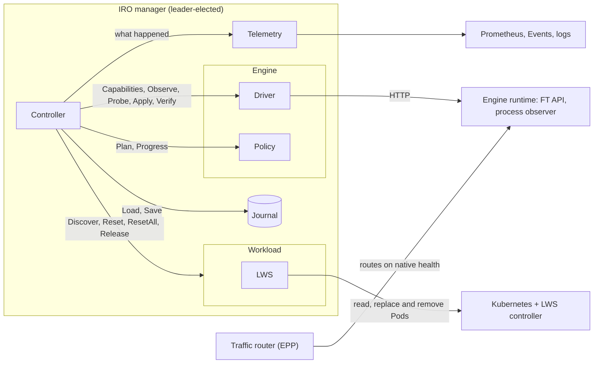

# Architecture

The llm-d Inference Resiliency Operator (IRO) provides automated failure detection and recovery for distributed
LLM inference on Kubernetes. It sequences the engine-side response and the infrastructure-side recovery
so serving keeps going and full capacity comes back without manual intervention.

IRO recovers one **engine group** at a time: the Pods that together run one engine (for example a
LeaderWorkerSet group running vLLM with data parallelism).

## Components

| Component | Owns | Must not know |
|---|---|---|
| [Controller](https://github.com/llm-d-incubation/llm-d-resiliency-operator/blob/main/internal/controller/enginefault/controller.go) | phases, deadlines, durability, mapping Pods to members, resets, restoring capacity, checks on every plan | engine states, ranks, Pod layout |
| [Journal](https://github.com/llm-d-incubation/llm-d-resiliency-operator/blob/main/internal/journal/journal.go) | durable controller state, one writer at a time | what the bytes mean |
| [Telemetry](https://github.com/llm-d-incubation/llm-d-resiliency-operator/blob/main/internal/controller/enginefault/recorder.go) | logs, metrics, Events, incident records. Best-effort, never read back. | how recovery decides anything |
| [Workload](https://github.com/llm-d-incubation/llm-d-resiliency-operator/blob/main/internal/workload/workload.go) | the group's Pods as they are now, resetting some Pods or all, releasing Pods | ranks, ports, engine processes |
| [Engine driver](https://github.com/llm-d-incubation/llm-d-resiliency-operator/blob/main/internal/engine/engine.go) | which members run on each Pod and their state, sending reconfigs, inference probes | phases, deadlines, Kubernetes |
| [Engine policy](https://github.com/llm-d-incubation/llm-d-resiliency-operator/blob/main/internal/engine/engine.go) | which members to remove or admit and when, how a reconfig is going | I/O, time, Kubernetes |

The controller only talks to interfaces. Adding a second engine or workload type means a new driver,
policy or workload, not changes to the controller.

## What IRO relies on

| External | What IRO relies on |
|---|---|
| Kubernetes + LWS controller | recreates the group after a reset, with its own backoff and restart limits |
| Engine runtime | exposes engine state and accepts reconfigs |
| Traffic router (EPP) | routes on the engine's native health. IRO never steers traffic. |
| Leader election | one controller acts on a group at a time |

Next: [Recovery flow](recovery-flow.md).
