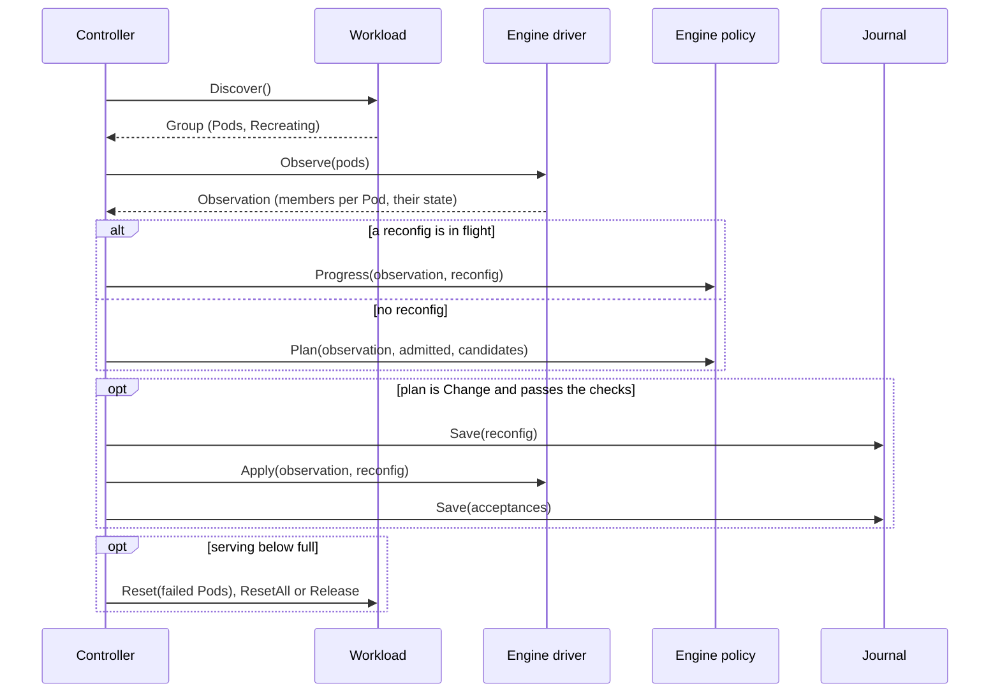

# Recovery flow

The example group has four Pods, `lws-0` to `lws-0-3`, each running one engine member, `dp0` to `dp3`.
`dp3` dies. The engine shrinks to `dp0`-`dp2`, IRO resets `lws-0-3`, and the new `dp3` is admitted
back. The group serves the whole time.

## One reconciliation step

Every poll, the controller reads the world, asks the engine policy what to do, and acts.

| Action | Delivery | Why |
|---|---|---|
| Engine reconfig (`Apply`) | saved first. Sent again only if no member got it. | a reconfig is not idempotent |
| Workload call (`Reset`, `ResetAll`, `Release`) | saved first, repeated until `Discover` shows the result | calls name Pods by UID, so repeating is harmless |

## From a fault back to full capacity

1. **Remove the dead member** (phase `recovering`). The driver reports `dp3` Terminal. The policy plans
   `Remove dp3`, the reconfig runs, and the survivors are verified.
2. **Reset the failed Pod** (phase `serving`, 3 members). `lws-0-3` holds only excluded members, so the
   workload resets it. The rest of the group keeps serving.
3. **Admit the new member.** The new Pod's `dp3` shows up as a candidate. The policy plans `Add dp3`,
   the reconfig runs, and the group is back to 4 members.

A new fault at any point comes first: the group goes back to `recovering`, and the capacity work
continues once it serves again.

Capacity only comes back by resetting, never from new Pods elsewhere. If the reset fails, the group keeps
serving with fewer members. `--ft-capacity-restore=reset-all` resets the whole group instead, and
`release` frees the failed Pod's GPUs.

See the [component interfaces](https://github.com/llm-d-incubation/llm-d-resiliency-operator/tree/main/internal) for the code.
